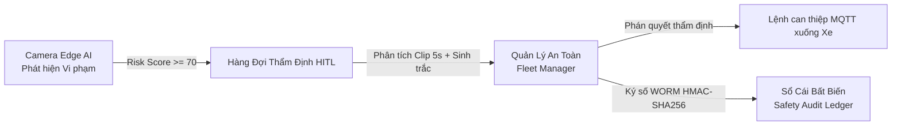
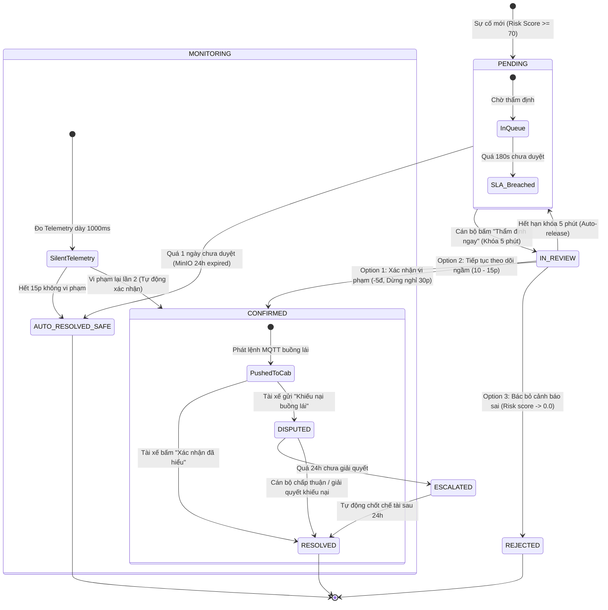
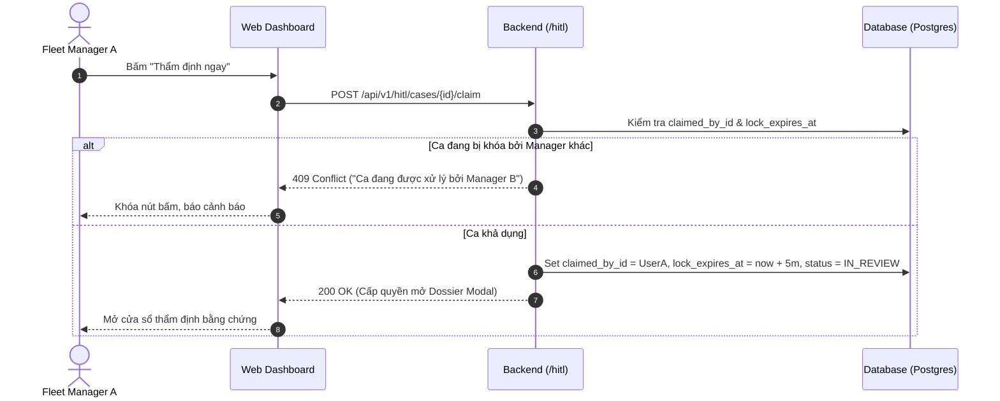
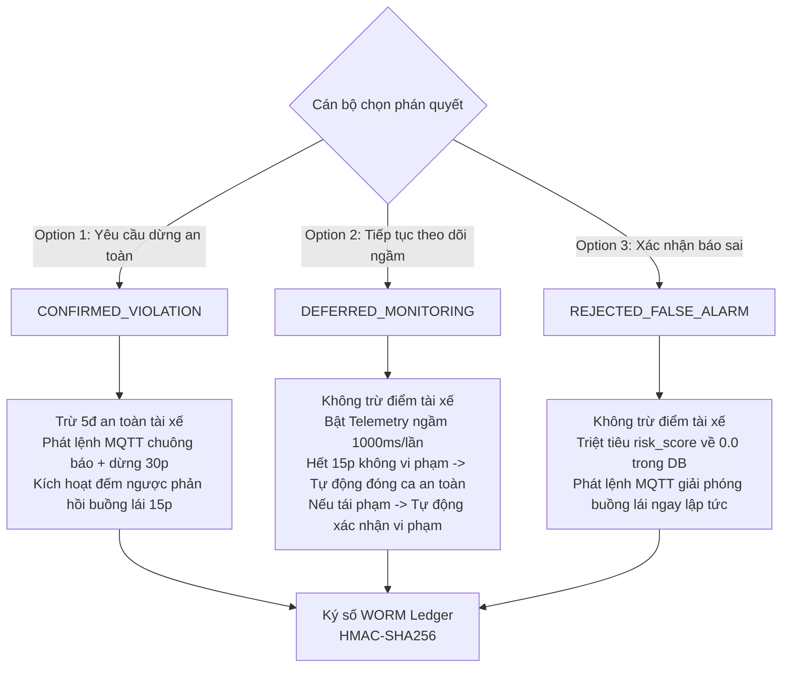
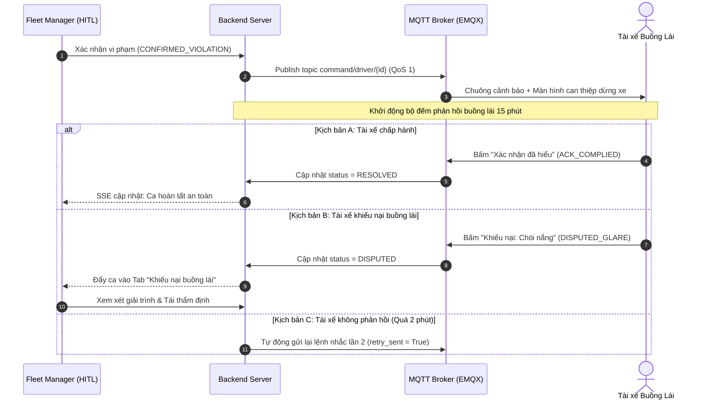

# 🛡️ TÀI LIỆU TOÀN DIỆN: LOGIC HÀNG ĐỢI THẨM ĐỊNH HITL (HUMAN-IN-THE-LOOP)

> **Hệ thống:** DriverGuard Safety Core Platform  
> **Module:** Human-in-the-Loop (HITL) Adjudication & Intervention Engine  
> **Đối tượng:** Fleet Safety Manager, Backend & Frontend Engineers, QA / Auditors  
> **Cập nhật:** Tháng 10/2026

---

## 📌 1. TỔNG QUAN & NGUYÊN TẮC THIẾT KẾ HITL

Hệ thống **HITL (Human-in-the-Loop)** được thiết kế để giải quyết bài toán cốt tử trong an toàn giao thông: **Kết hợp tốc độ của AI với tính pháp lý và độ chính xác của con người**.



### Nguyên tắc vận hành:
1. **Không can thiệp mù quáng:** AI Edge chỉ phân tích và gắn cờ rủi ro (`risk_score`), không tự ý ngắt động cơ hay phanh xe từ xa nhằm bảo đảm an toàn tính mạng.
2. **Khóa chống đụng độ (Review Lock):** Khi nhiều quản lý cùng trực ca, một ca đang xem sẽ bị khóa để tránh gửi trùng lệnh xuống tài xế.
3. **Thời gian vàng 180s (SLA Countdown):** Giới hạn 3 phút để can thiệp trước khi tài xế ngủ gật hoàn toàn dẫn đến tai nạn.
4. **Bảo vệ quyền lợi tài xế:** Cho phép tài xế gửi phản hồi xác nhận hoặc khiếu nại (Dispute) trực tiếp từ buồng lái.
5. **Chứng cứ pháp lý bất biến (WORM Ledger):** Mọi thao tác duyệt/bác bỏ đều được ký số không thể chối cãi.

---

## 🔄 2. SƠ ĐỒ VÒNG ĐỜI TRẠNG THÁI CA VI PHẠM (HITL STATE MACHINE)



---

## ⚙️ 3. CHI TIẾT CÁC QUY TRÌNH NGHIỆP VỤ CỐT LÕI

### 3.1. Tiếp nhận & Khử trùng lặp ca (Telemetry Ingest Logic)
Khi gói tin vi phạm gửi về từ xe (`SafetyAlertPayload`):
1. **Kiểm tra ca đang mở (`active_queue_case`):**
   - Nếu xe đã có ca ở trạng thái `PENDING` hoặc `IN_REVIEW`, hệ thống **không sinh thêm ca mới** làm ngập hàng đợi.
   - Ca hiện tại được cập nhật điểm rủi ro cao nhất, gộp tiền sự kiện (`precursor_events`) và ghi nhận vào lịch sử ca:
     `[NÂNG CẤP LÊN CRITICAL: Điểm rủi ro 100.0 - DISTRACTION]`.
2. **Kiểm tra ca đang theo dõi ngầm (`active_mon_case`):**
   - Nếu xe đang trong thời gian theo dõi ngầm mà tiếp tục vi phạm:
     👉 **Tự động chuyển thẳng sang `CONFIRMED` ("Xác nhận vi phạm")**, đóng thời gian theo dõi và kết thúc đồng hồ SLA sang `Hoàn tất`.
3. **Nếu là ca mới hoàn toàn:**
   - Tạo mới `HitlCase` với mã ca dạng: `case_hitl_{YYYYMMDD}_{hex6}` (Ví dụ: `case_hit1_20261016_569808`).

---

### 3.2. Cơ chế Khóa ca chống đụng độ (Claim Lock)



* **Cơ chế nhả khóa tự động:** Nếu Manager A đóng trình duyệt hoặc gặp sự cố mạng, background task chạy mỗi 15 giây sẽ quét:
  $$\text{lock\_expires\_at} \le \text{now} \implies \text{status} = \text{PENDING}, \text{claimed\_by\_id} = \text{NULL}$$

---

### 3.3. Bộ đếm ngược thời gian vàng can thiệp (SLA 180s)
* **Thời gian bắt đầu:** Tính từ `occurred_at` (thời điểm camera Edge AI ghi nhận vi phạm trên xe).
* **Công thức tính SLA còn lại:**
  $$\text{SLA\_Remaining} = \max\left(180 - (\text{now} - \text{occurred\_at})_{\text{seconds}}, 0\right)$$
* **Phân loại giao diện:**
  - $30\text{s} < \text{SLA} \le 180\text{s}$: Trạng thái bình thường (Xanh lá / Đầy thanh).
  - $0\text{s} < \text{SLA} \le 30\text{s}$: Báo động gấp (Vàng cam / Chớp nháy).
  - $\text{SLA} = 0\text{s}$: Vi phạm thời gian vàng (`is_sla_breached = True`, Đỏ).
  - **Khi đã có phán quyết:** Chuyển sang hiển thị huy hiệu `✓ Hoàn tất`.

---

### 3.4. Bộ 3 Phán quyết của Quản lý An toàn (Emergency Adjudication)



1. **Option 1 — Xác nhận vi phạm (`CONFIRMED_VIOLATION`):**
   - Áp dụng khi video xác thực tài xế ngủ gật, dùng điện thoại hoặc rời mắt khỏi làn đường.
   - Điểm an toàn tài xế bị trừ 5 điểm: `current_safety_score = max(0, score - 5)`.
   - Lệnh can thiệp gửi xuống xe qua MQTT topic `command/driver/{driver_id}` với QoS = 1.
2. **Option 2 — Tiếp tục theo dõi (`DEFERRED_MONITORING`):**
   - Áp dụng khi hành vi chưa đủ chắc chắn (chớp mắt chậm thoáng qua, ngáp 1 lần nhẹ).
   - Hệ thống đặt thời gian theo dõi 10 - 15 phút, kích hoạt chế độ thu thập dữ liệu nhạy bén ngầm không làm phiền tài xế.
3. **Option 3 — Bác bỏ cảnh báo sai (`REJECTED_FALSE_ALARM`):**
   - Phân loại 4 nguyên nhân ngoại cảnh:
     1. `SUNLIGHT_GLARE`: Chói nắng mặt trời trực diện làm nheo mắt.
     2. `GLASSES_REFLECTION`: Kính cận / kính râm phản quang ánh sáng.
     3. `SENSOR_MISIDENTIFICATION`: Cúi nhìn gương chiếu hậu / bảng taplo hợp lệ.
     4. `OTHER`: Ngoại cảnh khác (kèm ghi chú giải trình).
   - `risk_score` trong bảng `safety_alert_logs` được hoàn nguyên về `0.0` để giữ KPI sạch cho tài xế và đội xe.

---

### 3.5. Quy trình Phản hồi Buồng lái & Giải quyết Khiếu nại (Driver ACK & Dispute)



---

### 3.6. Cơ chế Tự động hóa Dọn dẹp nền (Background Cleaner Loop)
Chạy nền ngầm liên tục mỗi **15 giây** với 4 chức năng quét:
* **Quét 1: Giải phóng khóa xem:** Ca `IN_REVIEW` quá 5 phút chưa ra phán quyết $\to$ chuyển về `PENDING`.
* **Quét 2: Tự động đóng ca an toàn:** Ca `MONITORING` hết thời hạn giám sát mà không phát sinh thêm vi phạm $\to$ chuyển thành `AUTO_RESOLVED_SAFE`.
* **Quét 3: Miễn trừ hết hạn video 1 ngày (24h retention):** Video trên MinIO hết hạn lưu trữ sau 24h. Ca nào tồn đọng chưa duyệt $\to$ hệ thống tự động miễn trừ lỗi cho tài xế (`EXPIRED_EVIDENCE_1D_NO_FAULT`).
* **Quét 4: Chuẩn hóa ca tái phạm:** Bất kỳ ca nào tái phạm trong thời gian theo dõi $\to$ tự động chốt `CONFIRMED`.

---

## 🔒 4. SỔ CÁI BẤT BIẾN WORM AUDIT LEDGER (CHỐNG CHỐI BỎ)

Bảng **`safety_audit_ledger`** lưu vết toàn bộ can thiệp theo nguyên lý Blockchain thu nhỏ:

```mermaid
flowchart LR
    subgraph Block N-1
        P1[Block Height: 10]
        H1[Record Hash: a4f8...]
    end

    subgraph Block N
        P2[Block Height: 11]
        PH2[Previous Hash: a4f8...]
        DATA2[Payload Snapshot:\nCase ID, Action, Manager, Reason]
        SIG2[HMAC-SHA256 Signature]
    end

    Block N-1 -->|Liên kết chuỗi Hash| Block N
```

### Cấu trúc mã hóa:
1. **Liên kết chuỗi (`previous_hash`):** Mỗi bản ghi mới lấy hash của bản ghi trước đó. Nếu sửa đổi dữ liệu ở giữa, toàn bộ chuỗi hash phía sau sẽ gãy.
2. **Mã băm nội dung (`record_hash_sha256`):**
   $$\text{Hash} = \text{SHA256}\left(\text{prev\_hash} : \text{case\_id} : \text{action\_type} : \text{actor\_id} : \text{timestamp} + \text{JSON\_Payload}\right)$$
3. **Chữ ký số hệ thống (`signature_hmac`):**
   $$\text{Signature} = \text{HMAC-SHA256}\left(\text{SecretKey}, \text{record\_hash}\right)$$

---

## 📊 5. DANH MỤC API & MODEL DỮ LIỆU CỐT LÕI

### 5.1. Bảng `hitl_cases` (CSDL PostgreSQL)
| Tên Cột | Kiểu Dữ Liệu | Ràng Buộc | Ý Nghĩa Nghiệp Vụ |
| :--- | :--- | :--- | :--- |
| `id` | `VARCHAR(64)` | Primary Key | Mã ca thẩm định (`case_hitl_...`) |
| `alert_log_id` | `BIGINT` | Unique, FK | Khóa ngoại trỏ tới log vi phạm gốc |
| `vehicle_id` | `VARCHAR(64)` | FK | Biển số / ID phương tiện |
| `driver_id` | `VARCHAR(64)` | FK | ID tài xế đang nhận ca |
| `status` | `VARCHAR(32)` | Enum | `PENDING`, `IN_REVIEW`, `CONFIRMED`, `REJECTED`, `MONITORING`, `DISPUTED`, `AUTO_RESOLVED_SAFE`, `ESCALATED` |
| `decision` | `VARCHAR(32)` | Nullable | `CONFIRMED_VIOLATION`, `REJECTED_FALSE_ALARM`, `DEFERRED_MONITORING` |
| `claimed_by_id` | `VARCHAR(64)` | FK, Nullable | ID cán bộ đang khóa ca thẩm định |
| `lock_expires_at` | `TIMESTAMPTZ`| Nullable | Thời điểm hết hạn khóa 5 phút |
| `monitoring_expires_at`| `TIMESTAMPTZ`| Nullable | Thời điểm kết thúc theo dõi ngầm 15 phút |
| `escalation_count` | `INTEGER` | Default 0 | Số lần tái phạm / nâng cấp độ nghiêm trọng |
| `reject_reason` | `VARCHAR(64)` | Nullable | Lý do bác bỏ (`SUNLIGHT_GLARE`, ...) |

---

### 5.2. Danh mục API Endpoints

| Phương thức | Đường dẫn API | Mô tả |
| :--- | :--- | :--- |
| **GET** | `/api/v1/hitl/queue` | Lấy danh sách hàng đợi (Hỗ trợ phân trang, lọc theo status, thẻ thống kê realtime) |
| **POST** | `/api/v1/hitl/cases/{id}/claim` | Khóa nhận ca 5 phút tránh trùng lặp giữa các cán bộ |
| **POST** | `/api/v1/hitl/cases/{id}/unclaim` | Hủy khóa nhận ca trả lại hàng đợi |
| **GET** | `/api/v1/hitl/cases/{id}/dossier` | Lấy chi tiết hồ sơ chứng cứ (Video MP4, biểu đồ sinh trắc 5s, telemetry) |
| **POST** | `/api/v1/hitl/cases/{id}/decision` | Gửi phán quyết thẩm định (Xác nhận vi phạm hoặc Bác bỏ báo sai) |
| **POST** | `/api/v1/hitl/cases/{id}/defer-monitoring` | Kích hoạt chế độ theo dõi ngầm 10 - 15 phút |
| **GET** | `/api/v1/hitl/cases/{id}/audit-trail` | Truy xuất toàn bộ lịch sử can thiệp ký số WORM chống chối bỏ |
